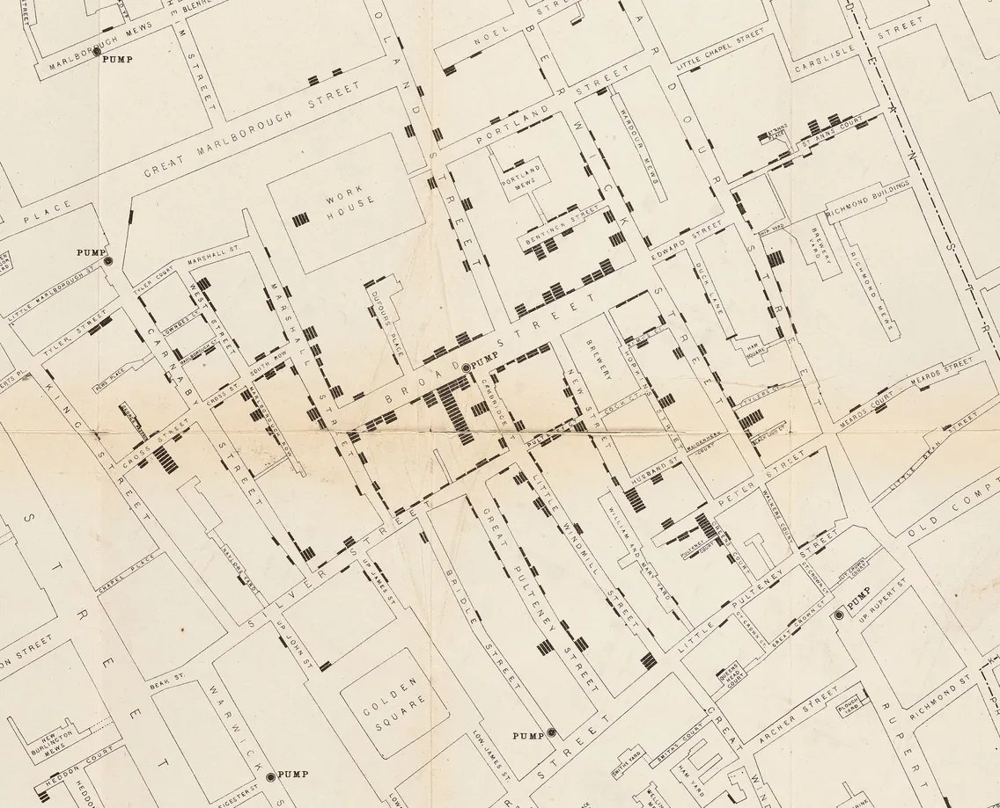
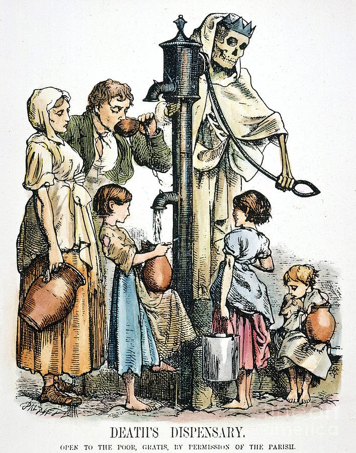
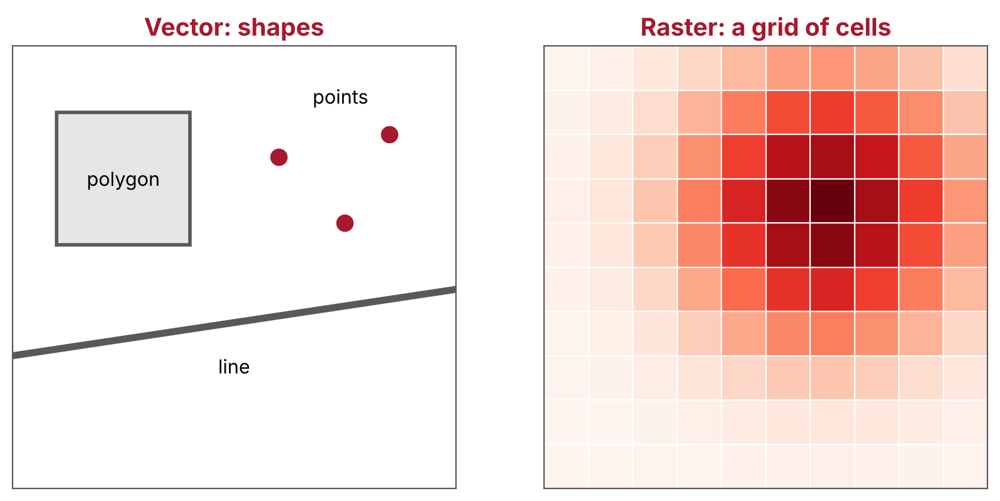
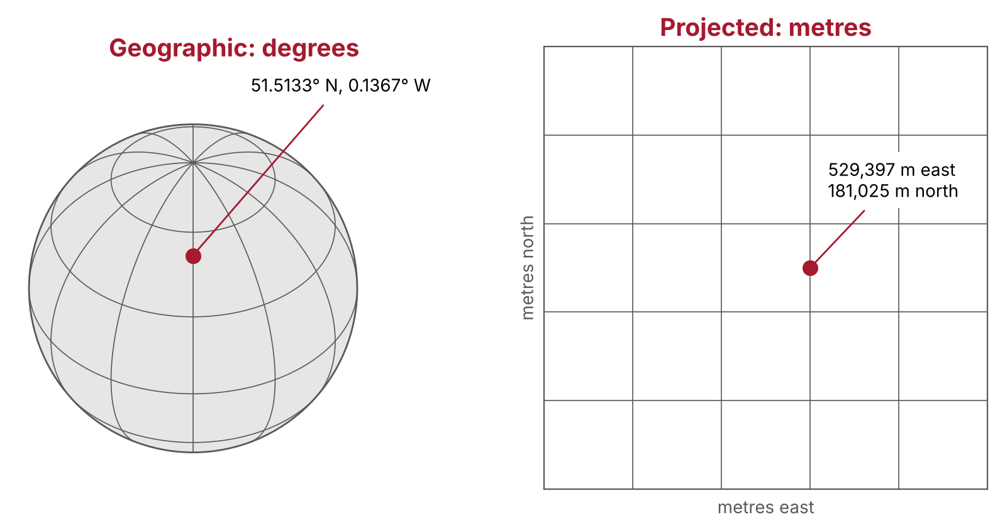
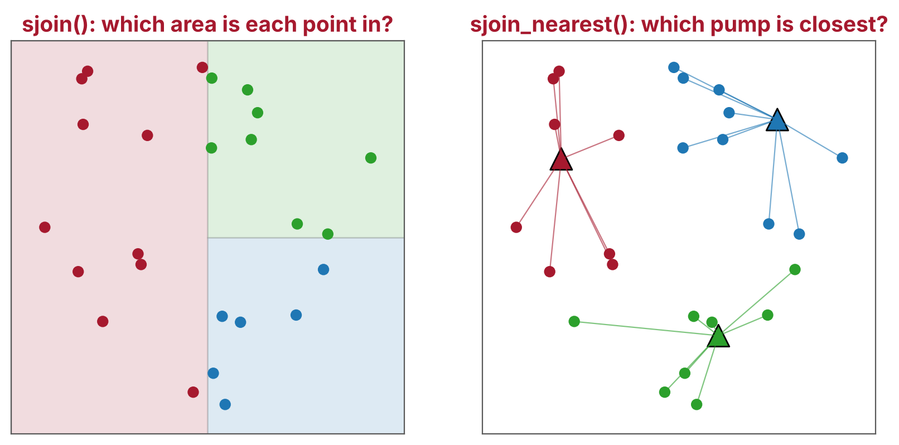
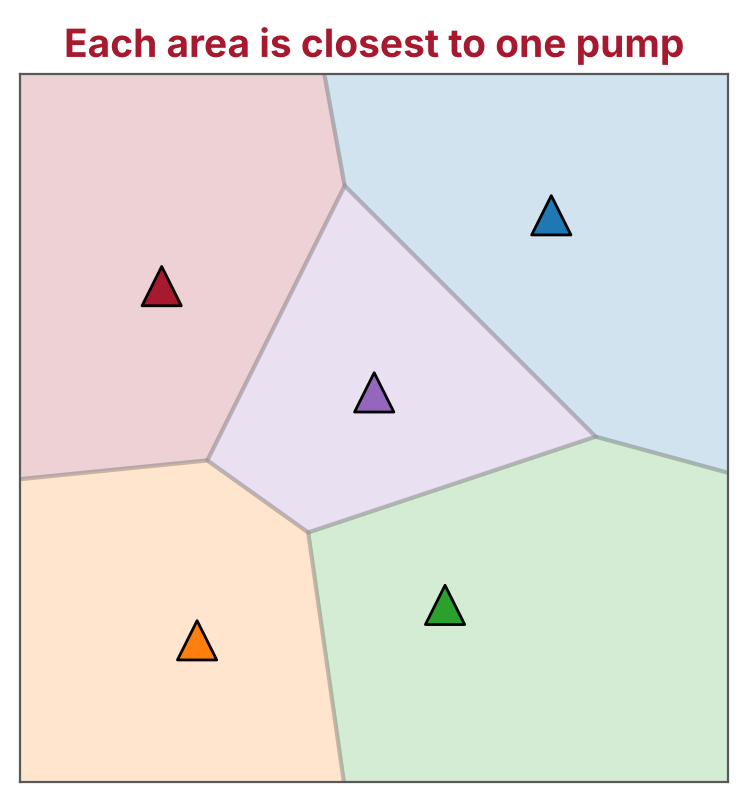
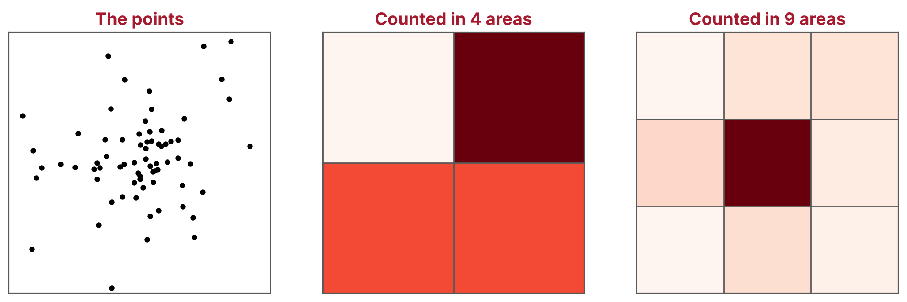

# Introduction {.unnumbered}

Welcome to this course! These notes go with the slides. You can use them afterwards to revisit the detail, and you can also **work through them on your own**: each section ends with a "Try it yourself" activity, with instructions and an answer you can open.

Most health data has a location attached: where a patient lives, where a GP surgery or hospital is, where a case of a disease was reported. Geospatial data science uses those locations to answer questions that a table alone cannot, such as who lives far from a service, or whether cases cluster in one place. In this course you will learn its main ideas, and how to put them into practice in Python with the `geopandas` library, by recreating John Snow's famous map of the 1854 cholera outbreak in Soho, London.

By the end of this course you will be able to:

1. Load location data into a GeoDataFrame, and describe how it differs from a pandas DataFrame.
2. Explain what a coordinate reference system (CRS) is, and check and change the CRS of a dataset.
3. Make a static map with a background map, and an interactive map.
4. Join datasets by location, for example to find the nearest water pump to each address.
5. Divide an area into catchments around points, and summarise data within each one.
6. Describe what a map can and cannot tell us, using Snow's map as an example.

<details class="how-to-read">
<summary>How to read this document</summary>

Small snippets of code are shown in a grey box like this:

```{.python}
print("Hello!")
```

When the code is run, its output is shown below it, marked with a vertical red line:

```{python}
print("Hello!")
```

Commands that install packages in Colab start with `%`:

```{.python filename="Colab"}
%pip install contextily
```

In each section there is a "Try it yourself" activity, which is also on the slides. Activities are shown in a box with a red top edge, and each one ends with a yellow box that contains the answer. Try each one yourself before looking at the answer.

::::: {.try-it}

[An example activity]{.try-it-title}

This is an exercise. Click the box below to see the answer.

::: {#answerN .callout-caution icon=false title='Answer (click to open)' collapse="true"}
This is the answer.
:::

:::::

Important points are highlighted in green boxes like this one:

::: {#keypointsN .callout-tip icon=false title='Key points'}
These are important concepts and technical notes.
:::

</details>

## The story {.unnumbered}

### London in the 1850s {.unnumbered}

London was growing fast, and many families lived crowded into old houses. Sewage went into cesspits under and behind the houses, and many people fetched their water from street pumps. Cholera had already swept through Britain in the 1830s and 1840s.

{fig-alt="Black and white photograph of a run-down London courtyard, with people standing and sitting outside old brick houses" width="60%"}

[Wikimedia Commons, public domain.]{.credit}

### What is cholera? {.unnumbered}

Cholera is a gut infection caused by the bacterium *Vibrio cholerae*. It spreads mainly through water and food contaminated with the bacterium, and causes acute watery diarrhoea, sometimes with vomiting. Most infected people have only mild symptoms, but in severe cases the dehydration can kill within hours if it is not treated. Today, most cases can be treated with oral rehydration solution ([Global Task Force on Cholera Control](https://www.gtfcc.org/about-cholera/cholera-facts/)).

In 1854, nobody knew about the bacterium: it was not isolated until 1883. Cholera was a terrifying and mysterious disease.

{fig-alt="A cartoon of cholera as a giant shrouded figure with skeletal hands and feet, trampling soldiers on a battlefield" width="60%"}

[National Library of Medicine, public domain.]{.credit}

### Two theories {.unnumbered}

Most doctors at the time believed in **miasma theory**: that diseases like cholera spread through "bad air", from rotting matter and filth. The physician John Snow thought cholera spread through contaminated water.

The two theories predict different patterns on a map. If bad air were to blame, deaths would be spread across a neighbourhood. If water were to blame, they would cluster around its source. This is why a map could help tell them apart.

### The Broad Street outbreak {.unnumbered}

The outbreak started on 30 August 1854. On 1 September alone, 143 people fell ill and later died. Snow studied the death records and visited the households of people who had died, and found that most of them had lived near, and drunk from, the water pump on Broad Street ([CDC, 2004](https://www.cdc.gov/mmwr/preview/mmwrhtml/mm5334a1.htm)). On the evening of 7 September he presented his evidence to the parish's Board of Guardians, and the pump's handle was removed the next day ([UCLA Department of Epidemiology](https://epi-snow.ph.ucla.edu/Stream2_BSPoutbreak_e.html)).

Snow then drew a map of the deaths, published in 1855 in the second edition of his book *On the Mode of Communication of Cholera*. Each death is a small black bar, stacked at the address where it happened, and the pumps are marked on the map.

{fig-alt="John Snow's map of Soho, with each cholera death drawn as a small black bar stacked at its address, clustered around Broad Street" width="80%"}

[Wellcome Collection.]{.credit}

Snow died in 1858, before his ideas were widely accepted. Within a decade, though, the link between dirty water and disease was a subject for cartoons.

{fig-alt="Cartoon of a skeleton working a street water pump, while poor women and children queue to fill jugs" width="45%"}

[Public domain.]{.credit}

### Our data {.unnumbered}

We use Robin Wilson's [digitised version of Snow's map](https://johnsnow.rtwilson.com/). He traced the deaths and the pumps from Snow's map, and lined them up with a modern map, so they can be used in modern software. His website lists teaching as one of its uses. The download has several files, and we use three of them:

| File | What it holds |
|---|---|
| `Cholera_Deaths.shp` | A point for each address where one or more people died. Its `Count` column is the number of deaths there. |
| `Pumps.shp` | A point for each water pump. There are no other columns: the pumps are not named. |
| `SnowMap.tif` | An image of Snow's map, lined up with the modern streets (used in an optional extra). |

::: {.big-statement}
489 deaths and 8 water pumps. Which pump was to blame?
:::

## Workspace setup {.unnumbered}

We use [Google Colab](https://colab.research.google.com/), which runs Python in your web browser. You need a Google account. Nothing needs to be installed on your computer.

1. [Open the course notebook in Colab](https://colab.research.google.com/github/Bristol-Training/geospatial-python/blob/main/notebooks/geospatial-python.ipynb).
2. Click **File → Save a copy in Drive**, so that your changes are saved. If Colab warns that the notebook was not written by Google, click **Run anyway**.
3. Run the first two cells: click in a cell and press **Shift + Enter**.

The first cell installs the packages we need, if Colab does not already have them:

```{.python filename="Colab"}
%pip install --quiet "geopandas>=1.0" contextily folium mapclassify
```

| Package | What it does |
|---|---|
| [geopandas](https://geopandas.org/) | Reads, analyses and plots tables of data with locations |
| [contextily](https://contextily.readthedocs.io/) | Adds background maps to plots |
| [folium](https://python-visualization.github.io/folium/) | Makes interactive web maps, used by geopandas's `explore()` |
| [mapclassify](https://pysal.org/mapclassify/) | Colour scales for maps, also needed by `explore()` |

The second cell downloads the data and unzips it:

```{python}
import urllib.request
import zipfile

url = "https://johnsnow.rtwilson.com/data/SnowGIS_SHP.zip"
urllib.request.urlretrieve(url, "SnowGIS_SHP.zip")

with zipfile.ZipFile("SnowGIS_SHP.zip") as zip_file:
    zip_file.extractall()
```

This makes a folder called `SnowGIS_SHP`. To see it, click the folder icon on the left of Colab.

::: {.callout-note icon=false title="Files in Colab are temporary"}
Colab deletes downloaded files when the session ends, for example if you close the tab or leave it idle for a while. If you come back later, run the notebook again from the top (**Runtime → Run before** in the cell you want to continue from).
:::

# Location data

[How is location data stored, and what do the numbers mean?]{.lead-question}

[About 35 min · Code along · Activity: Where is pump 0?]{.section-meta}

## What makes data geospatial?

Geospatial data has two parts: **where** something is, as coordinates, and **what** we know about it, such as the number of deaths at an address. The location is what makes it useful. It can link datasets that share nothing else, such as patients' postcodes and air pollution levels, and it can show patterns that a table hides.

### Why location matters {.unnumbered}

The geographer Waldo Tobler summed up why in 1970, in what is often called the "first law of geography":

> Everything is related to everything else, but near things are more related than distant things.

Neighbouring streets share the same air, water and services, so they tend to be alike. A cluster that stands out from its surroundings is therefore worth explaining. In 1854, a cluster of deaths around one pump pointed to the water.

## Vector and raster data

There are two ways to store the world as data:

{fig-alt="Left: a map with a square polygon, a line and three points. Right: the same area as a grid of cells, shaded from pale to dark red" width="90%"}

| | Vector | Raster |
|---|---|---|
| **Stores** | Shapes, each with a row of values | A grid of cells, each with a value |
| **Best for** | Things with edges: buildings, roads, addresses | Things that vary smoothly: air pollution, temperature |
| **Common files** | Shapefile, GeoPackage, GeoJSON | GeoTIFF |
| **Python library** | geopandas | rasterio, xarray |

A raster's **resolution**, the size of its cells, sets the smallest detail it can show. This course uses vector data. The only raster is `SnowMap.tif`, a scan of Snow's map, which we use as a background in an optional extra.

Vector data has three kinds of shape, or **geometry**:

- **Points**: an address, a pump, a hospital
- **Lines**: a road, a river, a bus route
- **Polygons**: a building, a postcode area, a catchment

This course uses points (the deaths and the pumps) and, in section 4, polygons.

## Reading the data

By convention, geopandas is imported as `gpd`, in the same way as pandas is imported as `pd`. `gpd.read_file()` reads location data in many formats, including shapefiles, GeoPackages and GeoJSON:

```{python}
import geopandas as gpd
import pandas as pd

deaths = gpd.read_file("SnowGIS_SHP/Cholera_Deaths.shp")
pumps = gpd.read_file("SnowGIS_SHP/Pumps.shp")
```

::: {.callout-note icon=false title="What is a shapefile?"}
A shapefile is an old but common format. It is really several files with the same name, which must be kept together:

- `.shp` holds the shapes (here, points)
- `.dbf` holds the table of values (here, the number of deaths)
- `.shx` is an index that links the two
- `.prj` describes the coordinate reference system (see below)

You point `read_file()` at the `.shp` file, and geopandas finds the rest. Newer formats, such as GeoPackage (`.gpkg`), keep everything in one file, and are a better choice for your own data.
:::

## A table with locations

Let's look at the first few rows:

```{python}
deaths.head()
```

This is a **GeoDataFrame**: a pandas DataFrame with a `geometry` column that holds a shape for each row.

```{python}
type(deaths)
```

Each row is an address. `Count` is the number of people who died there, and `geometry` is its location, written as `POINT (x y)`. geopandas stores these shapes using the [shapely](https://shapely.readthedocs.io/) library.

Everything you know about pandas still works on a GeoDataFrame. For example, `len()` counts the rows, and `.sum()` adds up a column:

```{python}
len(deaths), deaths["Count"].sum()
```

There are 250 addresses and 489 deaths. `value_counts()` counts how often each value appears, and `sort_index()` puts them in order. Most addresses had one death, and one had 15:

```{python}
deaths["Count"].value_counts().sort_index()
```

The pumps table has only locations:

```{python}
pumps
```

There are 8 pumps. The file does not include their names, so we give each one a number to refer to it by. `range(len(pumps))` counts from 0 to 7:

```{python}
pumps["pump_id"] = range(len(pumps))
```

We will find out which pump is which in the activity at the end of this section.

## A first look

`.plot()` draws the geometries, so you can check that the data looks sensible:

```{python}
#| fig-alt: "The locations of the cholera deaths as blue dots, with axis values in the hundreds of thousands"
deaths.plot()
```

We will make better maps in the next section. For now, look at the numbers on the axes. They are in the hundreds of thousands, so they are not latitude and longitude. What are they?

## Coordinate reference systems

A location is just a pair of numbers. To know where on Earth those numbers are, we need to know what they are measured from, and in what units. This is the **coordinate reference system** (CRS).

{fig-alt="Left: a globe with lines of latitude and longitude, and the Broad Street pump at 51.5133 north, 0.1367 west. Right: a flat grid in metres, with the same pump at 529,397 metres east and 181,025 metres north" width="90%"}

There are two kinds:

- A **geographic CRS** gives positions on the curved surface of the Earth, as latitude and longitude in degrees. GPS and most web maps use one called WGS 84.
- A **projected CRS** flattens the Earth onto a grid, usually in metres. Flattening a curved surface always distorts something: area, shape, distance or direction. No flat map can keep them all, so each projected CRS is designed for one area, where the distortion is small.

geopandas reads the CRS from the `.prj` file and stores it in `.crs`:

```{python}
deaths.crs
```

This data uses the **British National Grid**, a projected CRS designed for Great Britain. It measures positions in metres east and north of a point south-west of the Isles of Scilly, so the first address is about 529 km east and 181 km north of that point.

Common CRSs have a code from the [EPSG registry](https://epsg.io/). The two you will meet most often in the UK are:

| CRS | EPSG code | Units | Good for |
|---|---|---|---|
| British National Grid | 27700 | metres | Distances and areas in Great Britain |
| WGS 84 (latitude and longitude) | 4326 | degrees | GPS, sharing data, web maps |

This `.prj` file describes the CRS in words, without its EPSG code. It is good practice to state the CRS by its code, so that geopandas, and anyone reading your code, knows exactly which one it is:

```{python}
deaths = deaths.set_crs(27700, allow_override=True)
pumps = pumps.set_crs(27700, allow_override=True)
```

`allow_override=True` is needed because the data already has a CRS: it tells geopandas that we mean to replace it.

::: {.callout-warning icon=false title="set_crs() and to_crs() are different"}
- `set_crs()` **labels** the data with a CRS, without changing the numbers. Use it when the CRS is missing or wrong.
- `to_crs()` **converts** the numbers to a different CRS.

`set_crs()` with the wrong CRS puts your data in the wrong place on Earth, with no error.
:::

## Changing the CRS

To get latitude and longitude, convert the data to WGS 84:

```{python}
deaths_latlon = deaths.to_crs(4326)
deaths_latlon.head()
```

The same addresses now have coordinates in degrees. Points are written as `POINT (x y)`, so **longitude comes first**. Most people, and most web maps, write a location the other way round.

`.geometry.x` and `.geometry.y` give each coordinate on its own. Here, `y` is the latitude:

```{python}
deaths_latlon.geometry.y.head()
```

## Why the CRS matters

The CRS matters most when you measure things. `.distance()` measures the distance from each point to a shape. `pumps.geometry.iloc[0]` picks out the location of the first pump, and we measure the distance from each address to it:

```{python}
first_pump = pumps.geometry.iloc[0]
deaths.distance(first_pump).head()
```

In the British National Grid, the answer is in metres. In latitude and longitude, it is in degrees:

```{python}
first_pump_latlon = pumps.to_crs(4326).geometry.iloc[0]
deaths_latlon.distance(first_pump_latlon).head()
```

A degree is not a fixed distance: a degree of longitude is about 111 km at the equator, about 69 km in London, and shrinks to nothing at the poles. geopandas warns you about this. **To measure distances or areas, use a projected CRS in metres**, such as the British National Grid in Great Britain.

::: {.callout-note icon=false title="Layers need the same CRS"}
To combine two layers, in a plot or an analysis, they must use the same CRS. If they do not, convert one with `to_crs()`. geopandas warns you if they do not match.
:::

## Learn more about location data

- [GeoPandas: introduction](https://geopandas.org/en/stable/getting_started/introduction.html)
- [GeoPandas: managing projections](https://geopandas.org/en/stable/docs/user_guide/projections.html)
- [*Python for Geographic Data Analysis*](https://pythongis.org/): vector and raster data, and CRSs
- [epsg.io](https://epsg.io/): look up any CRS

::::: {.try-it}

## Try it yourself {.unnumbered}

### Where is pump 0? {#exercise1 .unnumbered}

1. Convert `pumps` to latitude and longitude.
2. Find the latitude and longitude of pump 0 (the first row).
3. Paste them into Google Maps or OpenStreetMap as `latitude, longitude`. Which street is it on?

::: {#answer1 .callout-caution icon=false title='Answer (click to open)' collapse="true"}
```{python}
pumps_latlon = pumps.to_crs(4326)
pumps_latlon.geometry.y.iloc[0], pumps_latlon.geometry.x.iloc[0]
```

Pump 0 is at about 51.5133, -0.1367, on Broadwick Street in Soho. In 1854 this was Broad Street: **pump 0 is the Broad Street pump**. A replica of the pump stands there today.

If your map shows the Indian Ocean, you have swapped the numbers: web maps expect latitude first, but `POINT (x y)` puts longitude first.
:::

:::::

::: {#keypoints1 .callout-tip icon=false title='Key points'}
- Geospatial data is *where* plus *what*. Near things tend to be alike, so clusters are worth explaining.
- Vector data stores shapes; raster data stores a grid of cells.
- A GeoDataFrame is a pandas DataFrame with a `geometry` column.
- A CRS says what the coordinates mean. `set_crs()` labels the data; `to_crs()` converts it.
- Measure distances and areas in a projected CRS that uses metres.
:::

# Making maps

[How do we turn a table of points into a map that people can read?]{.lead-question}

[About 25 min · Code along · Activity: An interactive map]{.section-meta}

## What makes a good map?

A good map has four things: the **data** you want people to look at, drawn so it stands out; enough **context**, such as a background map, for readers to know where they are; a **key** or caption that says what the symbols mean; and a **credit** for where the data and background map came from.

Maps show values through what cartographers call **visual variables**:

| | Good for | In geopandas | On Snow's map |
|---|---|---|---|
| **Size** | Amounts, such as a count | `markersize=` | The height of each stack of bars |
| **Colour** | Amounts, or categories | `column=`, `cmap=` | Not used |
| **Shape** | Different kinds of thing | `marker=` | Bars for deaths, dots for pumps |

We will build a map in layers, like sheets of tracing paper: the deaths, then the pumps on top, then a street map underneath.

## Layers

`.plot()` uses the matplotlib library, and returns a matplotlib `Axes`: the area of the figure that the map is drawn in. If we save it as `ax` and pass it to the next `.plot()` with `ax=ax`, the next layer is drawn on the same map.

Each point is an address, and some addresses had many deaths. Like Snow's stacked bars, we can show this by the size of each dot. `markersize` takes either a single number or a column, so we multiply the `Count` column by 10 to make the dots big enough to see:

```{python}
#| fig-alt: "Cholera deaths as black dots sized by the number of deaths, and pumps as blue triangles"
ax = deaths.plot(
    color="black", markersize=deaths["Count"] * 10, alpha=0.7, figsize=(8, 8)
)
pumps.plot(ax=ax, color="blue", marker="^", markersize=80)
ax.set_axis_off()
```

The other settings are:

- `alpha=0.7` makes the dots slightly see-through, so overlapping dots stay visible.
- `figsize=(8, 8)` sets the size of the figure, in inches.
- `marker="^"` draws the pumps as triangles, so they stand out from the deaths.
- `ax.set_axis_off()` hides the axis values, which readers of a map do not need.

The cluster around one pump is already clear.

## A background map

Without streets, it is hard to tell where these points are. The `contextily` package adds a background map, made from the same small square images ("tiles") as web maps:

```{python}
#| fig-alt: "Cholera deaths and pumps on a street map of Soho"
import contextily as cx

ax = deaths.plot(
    color="black", markersize=deaths["Count"] * 10, alpha=0.7, figsize=(8, 8)
)
pumps.plot(ax=ax, color="blue", marker="^", markersize=80)
cx.add_basemap(ax, crs=deaths.crs, source=cx.providers.Esri.WorldStreetMap)
ax.set_axis_off()
```

- `crs=deaths.crs` tells contextily the CRS of our data. Map tiles use their own CRS, so contextily converts them to match.
- `source` chooses the map. We use Esri's street map.

Keep the attribution in the corner: the people who made the map require it. `cx.providers` lists many other maps, but some now need a key, or block requests from code.

To save a map as an image, for a report or slides, use `ax.figure.savefig("map.png", dpi=300)`. `dpi` sets the resolution: 300 is good for print.

::: {.callout-note icon=false title="In geopandas 1.2 and later"}
geopandas 1.2 (September 2026) can add the background map itself, with `.plot(tiles=...)`. Colab may have an older version, so these notes use contextily, which works with every version.
:::

## An interactive map

`.explore()` makes an interactive map that you can zoom, pan and hover over. It converts the data to the CRS that web maps use for you:

```{python}
deaths.explore(
    column="Count",
    cmap="Reds",
    marker_kwds={"radius": 4},
    tiles="Esri.WorldStreetMap",
)
```

- `column="Count"` colours each point by its number of deaths, and `cmap` chooses the colours.
- `marker_kwds={"radius": 4}` sets the size of the dots, in pixels.
- `tiles` chooses the background map, by name.

Hover over a point to see its row of the table.

::: {.callout-note icon=false title="Static or interactive?"}
Use `.plot()` for reports, papers and slides, where the map has to work on paper. Use `.explore()` to explore your data, or to share a map as a web page with `.save("map.html")`.
:::

::: {.callout-tip icon=false title="Optional extra: Snow's original map"}
`SnowMap.tif` is a raster: a scan of Snow's map, lined up with the modern streets. contextily can use it as the background, instead of a map from the web:

```{python}
#| fig-alt: "Cholera deaths and pumps on John Snow's original 1854 map"
ax = deaths.plot(
    color="red", markersize=deaths["Count"] * 10, alpha=0.7, figsize=(8, 8)
)
pumps.plot(ax=ax, color="blue", marker="^", markersize=80)
cx.add_basemap(ax, crs=deaths.crs, source="SnowGIS_SHP/SnowMap.tif")
ax.set_axis_off()
```

The red dots sit on Snow's black bars, which shows that the data lines up with his map.
:::

## Learn more about maps

- [GeoPandas: mapping and plotting](https://geopandas.org/en/stable/docs/user_guide/mapping.html)
- [GeoPandas: interactive maps](https://geopandas.org/en/stable/docs/user_guide/interactive_mapping.html)
- [contextily](https://contextily.readthedocs.io/): background maps

::::: {.try-it}

## Try it yourself {.unnumbered}

### An interactive map {#exercise2 .unnumbered}

1. Make the interactive map of the deaths, as above, and save it as `m`.
2. Add the pumps as a second layer, with `pumps.explore(m=m, color="blue")`. Passing `m=m` draws on the same map, like `ax=ax` does for `.plot()`.
3. Give each layer a name, with `name="Deaths"` and `name="Pumps"`, then add a layer control so you can turn them on and off:

    ```{.python}
    import folium

    folium.LayerControl().add_to(m)
    m
    ```

4. Hover over the points to find the address with the most deaths. Is it near a pump?

::: {#answer2 .callout-caution icon=false title='Answer (click to open)' collapse="true"}
```{python}
import folium

m = deaths.explore(
    column="Count",
    cmap="Reds",
    marker_kwds={"radius": 4},
    tiles="Esri.WorldStreetMap",
    name="Deaths",
)
pumps.explore(m=m, color="blue", marker_kwds={"radius": 8}, name="Pumps")
folium.LayerControl().add_to(m)
m
```

The address with 15 deaths is next to the Broad Street pump. `idxmax()` finds the row with the largest `Count`, and `.distance()` shows how close it is:

```{python}
worst = deaths.loc[deaths["Count"].idxmax()]
worst["geometry"].distance(pumps.geometry.iloc[0])
```

It is about 17 metres away.
:::

:::::

::: {#keypoints2 .callout-tip icon=false title='Key points'}
- A good map has data, context, a key and a credit.
- Build a map in layers, with `ax=ax`.
- Size, colour and shape show values from the table.
- `cx.add_basemap()` adds a background map. Keep the attribution.
- `.explore()` makes an interactive map. Add layers with `m=`.
:::

# The nearest pump

[Which pump was closest to each death?]{.lead-question}

[About 30 min · Code along · Activity: Deaths within 100 metres]{.section-meta}

Snow's argument was that the deaths clustered around the Broad Street pump. We can test this by finding the nearest pump to each address, and adding up the deaths for each pump.

## Spatial relationships

Shapes can relate to each other in a few ways. Two shapes can **intersect** (touch or overlap), one can **contain** the other, or they can be some **distance** apart. These relationships, called spatial predicates, are what let us join tables by location.

{fig-alt="Left: points coloured by which of three areas they fall in. Right: points joined by lines to the nearest of three pumps, and coloured to match" width="90%"}

In pandas, you join two tables using a column they share, such as a patient ID. A **spatial join** joins them by location instead:

| Join | Function | Matches rows that |
|---|---|---|
| By a column | `pd.merge()` | Have the same value in a shared column |
| By location | `sjoin()` | Have shapes that intersect, or where one contains the other |
| To the nearest | `sjoin_nearest()` | Are closest to each other |

A spatial join links datasets that share nothing but their location. For example, it can give each patient's postcode the area it is in, so it can be matched to deprivation data for that area.

## Joining by location

`sjoin_nearest()` gives each address the columns of its nearest pump:

```{python}
nearest = deaths.sjoin_nearest(pumps, distance_col="distance")
nearest.head()
```

The table still has one row for each of the 250 addresses, with three new columns:

- `index_right` is the pump's row in `pumps`. geopandas adds it to every spatial join.
- `pump_id` is the pump's number, from the `pumps` table.
- `distance` is the distance to the pump. We asked for it with `distance_col`. The data is in the British National Grid, so it is in metres.

`sjoin_nearest()` measures in a straight line, "as the crow flies". People walk along streets, so the nearest pump is not always the quickest to reach. We come back to this in section 5.

## Deaths per pump

Now we can add up the deaths for each pump. `groupby("pump_id")` puts the rows into groups, one for each pump, and `["Count"].sum()` adds up the deaths in each group:

```{python}
deaths_per_pump = nearest.groupby("pump_id")["Count"].sum()
deaths_per_pump.sort_values(ascending=False)
```

As a percentage of all deaths:

```{python}
percent = 100 * deaths_per_pump / deaths["Count"].sum()
percent.round(1).sort_values(ascending=False)
```

Of the 489 deaths, 340 (70%) were at addresses where the nearest pump was the Broad Street pump. The next highest pump had 65. Pumps 3 and 6 are missing from the table: no address had them as its nearest pump.

`describe()` summarises the distances:

```{python}
nearest["distance"].describe()
```

On average, an address was about 105 metres from its nearest pump, and the furthest was about 316 metres away.

## Mapping the result

Colouring each address by its nearest pump shows the area each pump was closest to. `categorical=True` treats the pump numbers as labels, not as numbers on a scale, and `cmap="tab10"` gives each one a different colour:

```{python}
#| fig-alt: "Deaths coloured by their nearest pump, with most in the colour of pump 0"
ax = nearest.plot(
    column="pump_id",
    categorical=True,
    legend=True,
    cmap="tab10",
    markersize=nearest["Count"] * 10,
    figsize=(8, 8),
)
pumps.plot(ax=ax, color="black", marker="^", markersize=80)
cx.add_basemap(ax, crs=deaths.crs, source=cx.providers.Esri.WorldStreetMap)
ax.set_axis_off()
```

## Learn more about spatial joins

- [GeoPandas: merging data](https://geopandas.org/en/stable/docs/user_guide/mergingdata.html)
- [Shapely: spatial predicates](https://shapely.readthedocs.io/en/stable/manual.html#binary-predicates)

::::: {.try-it}

## Try it yourself {.unnumbered}

### Deaths within 100 metres {#exercise3 .unnumbered}

1. Save the location of pump 0 as `broad_street`, with `pumps.geometry.iloc[0]`.
2. Use `deaths.distance(broad_street)` to find the addresses within 100 metres of it.
3. How many deaths were at those addresses? What percentage of all deaths is that?

**Extra:** `broad_street.buffer(100)` makes a circle with a radius of 100 metres around the pump. Draw it on a map with the deaths.

::: {#answer3 .callout-caution icon=false title='Answer (click to open)' collapse="true"}
`deaths.distance(broad_street) <= 100` is `True` for the addresses within 100 metres, and putting it in square brackets keeps only those rows:

```{python}
broad_street = pumps.geometry.iloc[0]
within_100m = deaths[deaths.distance(broad_street) <= 100]
deaths_near = within_100m["Count"].sum()
deaths_near, 100 * deaths_near / deaths["Count"].sum()
```

196 deaths, 40% of the total, were within 100 metres of the Broad Street pump.

For the extra, `.buffer()` makes an area of a fixed distance around a shape. To plot it, put it in a GeoSeries (a column of geometries) with a CRS:

```{python}
#| fig-alt: "A 100 metre circle around the Broad Street pump, containing many of the deaths"
circle = gpd.GeoSeries([broad_street.buffer(100)], crs=deaths.crs)

ax = circle.plot(color="orange", alpha=0.3, figsize=(8, 8))
deaths.plot(ax=ax, color="black", markersize=deaths["Count"] * 10)
pumps.plot(ax=ax, color="blue", marker="^", markersize=80)
cx.add_basemap(ax, crs=deaths.crs, source=cx.providers.Esri.WorldStreetMap)
ax.set_axis_off()
```
:::

:::::

::: {#keypoints3 .callout-tip icon=false title='Key points'}
- Shapes can intersect, contain each other, or be a distance apart.
- A spatial join combines tables by location instead of by a shared column.
- `sjoin_nearest()` finds the nearest feature, and `distance_col` records the distance.
- After a spatial join, use pandas to group and summarise the table.
:::

# Pump catchments

[Which area did each pump serve?]{.lead-question}

[About 25 min · Code along · Activity: A map of catchments]{.section-meta}

## Voronoi polygons

In the last section we matched each address to its nearest pump. We can also draw the whole **area** that is closer to each pump than to any other. These areas are called **Voronoi polygons**. Their edges are the lines where you are exactly the same distance from two pumps.

{fig-alt="Five pumps, each inside its own coloured area. Every point in an area is closer to that area's pump than to any other" width="50%"}

They are named after the mathematician Georgy Voronoy, who studied them in 1908. They are also called **Thiessen polygons**, after Alfred Thiessen, who used them in 1911 to estimate rainfall from scattered rain gauges. Today they are used to draw catchments, such as the area nearest each GP surgery or hospital.

Snow drew one too. For the parish's inquiry into the outbreak, he redrew his map with a dotted line around the area that was closer to the Broad Street pump than to any other. He measured the distance along the streets, not in a straight line, and his map may be the earliest use of this kind of diagram ([UCLA Department of Epidemiology](https://epi-snow.ph.ucla.edu/Stream2_BSPoutbreak_f.html)).

## Drawing the polygons

The outer polygons would stretch out forever, so first we make a box around the data to give them an edge. `total_bounds` gives the smallest and largest x and y values of all the points. We add 50 metres on each side, and shapely's `box()` turns the four values into a rectangle:

```{python}
from shapely.geometry import box

all_points = pd.concat([deaths.geometry, pumps.geometry])
xmin, ymin, xmax, ymax = all_points.total_bounds
study_area = box(xmin - 50, ymin - 50, xmax + 50, ymax + 50)
```

`pd.concat()` stacks the deaths and the pumps into one column, so that the box covers both.

`voronoi_polygons()` draws a polygon around each pump, out to the edge of the box:

```{python}
cells = pumps.voronoi_polygons(extend_to=study_area)
cells
```

There are 8 polygons, one for each pump. But they are not in the same order as the pumps, so we cannot copy the `pump_id` column across.

## Labelling the polygons

Each polygon contains exactly one pump, so a spatial join can find it. `sjoin()` joins rows whose shapes meet, and `predicate` sets the rule. `predicate="contains"` keeps the pairs where the polygon contains the pump. `.clip()` then trims the polygons to the box:

```{python}
catchments = gpd.GeoDataFrame(geometry=cells)
catchments = catchments.sjoin(pumps, predicate="contains").clip(study_area)
catchments
```

```{python}
#| fig-alt: "Soho divided into a polygon around each pump"
ax = catchments.plot(
    column="pump_id",
    categorical=True,
    legend=True,
    cmap="tab10",
    alpha=0.4,
    edgecolor="black",
    figsize=(8, 8),
)
pumps.plot(ax=ax, color="black", marker="^", markersize=80)
deaths.plot(ax=ax, color="black", markersize=deaths["Count"] * 5)
cx.add_basemap(ax, crs=deaths.crs, source=cx.providers.Esri.WorldStreetMap)
ax.set_axis_off()
```

## Deaths in each catchment

To count the deaths in each catchment, we join the deaths to the polygons they fall in. By default, `sjoin()` uses `predicate="intersects"`, which keeps the pairs that touch or overlap. We only need the `pump_id` and `geometry` columns of the catchments:

```{python}
deaths_in_catchment = deaths.sjoin(catchments[["pump_id", "geometry"]])
deaths_in_catchment.groupby("pump_id")["Count"].sum()
```

These are the same totals as in section 3. Each polygon is the area nearest its pump, so the two methods must agree. What the polygons add is the areas themselves, including the places where no one died.

## Choropleth maps

A map of areas, each shaded by a value, is called a **choropleth**. Choropleths are the most common kind of map in public health, and they are easy to misread:

- **Counts mislead.** Areas with more people have more deaths, whatever the cause.
- **Rates are fairer.** Deaths per 1,000 people lets you compare areas with different populations.

We do not know how many people lived near each pump, so we can only map counts here.

## Learn more about catchments and choropleths

- [GeoPandas: `voronoi_polygons()`](https://geopandas.org/en/stable/docs/reference/api/geopandas.GeoSeries.voronoi_polygons.html)
- [GeoPandas: choropleth maps](https://geopandas.org/en/stable/docs/user_guide/mapping.html#choropleth-maps)

::::: {.try-it}

## Try it yourself {.unnumbered}

### A map of catchments {#exercise4 .unnumbered}

Make a map of the catchments, shaded by their number of deaths.

1. Add a `deaths` column to `catchments`. `.map()` looks up each `pump_id` in the totals, and `.fillna(0)` gives 0 to the pumps with no deaths:

    ```{.python}
    totals = deaths_in_catchment.groupby("pump_id")["Count"].sum()
    catchments["deaths"] = catchments["pump_id"].map(totals).fillna(0)
    ```

2. Plot `catchments` with `column="deaths"`, `cmap="Reds"` and `legend=True`. Add the pumps and a background map.
3. Which catchments had no deaths?

::: {#answer4 .callout-caution icon=false title='Answer (click to open)' collapse="true"}
```{python}
#| fig-alt: "Pump catchments shaded by number of deaths, with the Broad Street catchment darkest"
totals = deaths_in_catchment.groupby("pump_id")["Count"].sum()
catchments["deaths"] = catchments["pump_id"].map(totals).fillna(0)

ax = catchments.plot(
    column="deaths",
    cmap="Reds",
    legend=True,
    edgecolor="black",
    figsize=(8, 8),
)
pumps.plot(ax=ax, color="blue", marker="^", markersize=80)
cx.add_basemap(ax, crs=deaths.crs, source=cx.providers.Esri.WorldStreetMap)
ax.set_axis_off()
```

```{python}
catchments.loc[catchments["deaths"] == 0, "pump_id"]
```

Pumps 3 and 6 had no deaths in their catchments. Both are at the edge of the area where deaths were recorded.
:::

:::::

::: {#keypoints4 .callout-tip icon=false title='Key points'}
- Voronoi polygons divide an area into the parts nearest each point. Snow drew an early one.
- `voronoi_polygons()` does not keep the input order, so label the polygons with a spatial join.
- `sjoin()` joins by location. `predicate` sets the rule, such as `"intersects"` or `"contains"`.
- A choropleth shades areas by a value. Where you can, map rates rather than counts.
:::

# What the map cannot tell us

[Should we believe it?]{.lead-question}

[About 20 min · Discussion · Activity: Question the map]{.section-meta}

Our analysis points strongly at the Broad Street pump. But a map is a summary, and every summary leaves things out. This section has no new code.

## The evidence beyond the map

People choose a pump for many reasons, such as habit, the taste of the water, or whether it is on their way to work. Distance along the streets is also different from distance in a straight line. For some addresses, the Rupert Street pump was closer in a straight line, but dead ends made the Broad Street pump quicker to reach.

The exceptions were some of Snow's strongest evidence ([University of East Anglia](https://applieddatascience.cmp.uea.ac.uk/02/1/observation-and-visualization-john-snow-and-the-broad-street-pump.html)):

- **The brewery:** there were no deaths in the two blocks just east of the pump, where there was a brewery. It had its own well, and the workers drank its beer.
- **The Hampstead widow:** Susannah Eley had once lived in Broad Street. After moving to Hampstead, she had water from the Broad Street pump delivered every day. She and her niece caught cholera.

Later, Henry Whitehead, a local curate who had at first doubted Snow, traced the first case to a baby at 40 Broad Street. Her mother emptied the washing water into a cesspit next to the pump, and the cesspit leaked into the pump's well ([Science History Institute](https://www.sciencehistory.org/stories/magazine/john-snow-hunts-the-blue-death/)).

None of these shows up as a cluster on a map. They came from talking to people.

## The limits of the data

- **Where people died, not where they drank:** the map shows home addresses.
- **Who is missing:** people who caught cholera in Soho but died somewhere else, like Susannah Eley, are not on it.
- **Accuracy:** Snow drew his map by hand, and our data was traced from it, so the positions are approximate.
- **Timing:** the outbreak was already slowing when the handle was removed, so the map cannot show that removing it ended the outbreak.
- **Correlation, not cause:** a cluster of deaths around a pump does not prove that the pump caused them. Snow's case was persuasive because the map fitted with the other evidence.

## The boundaries change the picture

Health data is usually released for areas, such as postcode areas or LSOAs, not for addresses, to protect people's privacy. But the areas you count in can change what you see. This is called the **modifiable areal unit problem** (MAUP), and it has two parts:

- **Scale:** the same data, counted in bigger or smaller areas, can show a different pattern.
- **Zoning:** at the same scale, moving the boundaries can change the pattern too.

{fig-alt="The same set of points counted in four large squares and in nine smaller squares. With four squares, one corner looks worst; with nine, the centre does" width="100%"}

In the diagram, the points cluster in the middle. Counted in four squares, the boundaries cut the cluster into pieces, and one corner looks worst. Counted in nine, the cluster falls in the middle square. Our pump catchments are one choice of areas: different boundaries would give a different map.

## The same questions today

The methods in this course are used in public health today, and the same questions apply:

- **Access:** the straight-line distance to a GP surgery is not the same as the travel time by bus.
- **Areas:** the boundaries chosen can change the pattern you see.
- **Who is counted:** a map only shows the people in the data.

::::: {.try-it}

## Try it yourself {.unnumbered}

### Question the map {#exercise5 .unnumbered}

Pick one question, and write your answer in the chat:

1. If you only had the catchment map, and no interviews, what could you wrongly conclude?
2. What extra data would make the analysis stronger?
3. Think of location data from your own work. What would a map of it leave out?

::: {#answer5 .callout-caution icon=false title='Answer (click to open)' collapse="true"}
There is no single right answer. Some points to consider:

1. That everyone used their nearest pump, or that the pump caused the deaths. You would also miss the exceptions, which were some of the strongest evidence.
2. Where each person got their water, walking distances along the streets of 1854, the date of each death, and the number of people living at each address. Without the population, you cannot tell a high *rate* of deaths from a crowded street.
3. Common answers include people missing from the data, when things happened, the reasons behind people's choices, and the effect of the areas chosen.
:::

:::::

::: {#keypoints5 .callout-tip icon=false title='Key points'}
- Straight-line distance is not the route people take, or the choice they make.
- A map shows where events were recorded, not why they happened.
- Snow's map was persuasive because it fitted with other evidence.
- The areas you count in can change the pattern (the MAUP).
:::

# Summary {.unnumbered}

In this course you have used geopandas to recreate John Snow's analysis:

| Task | Code |
|---|---|
| Read a file | `gpd.read_file("file.shp")` |
| Check the CRS | `gdf.crs` |
| Label the CRS | `gdf.set_crs(27700, allow_override=True)` |
| Convert the CRS | `gdf.to_crs(4326)` |
| Static map | `gdf.plot(ax=ax)` |
| Background map | `cx.add_basemap(ax, crs=gdf.crs, source=...)` |
| Interactive map | `gdf.explore(m=m)` |
| Distance | `gdf.distance(shape)` |
| Nearest join | `gdf.sjoin_nearest(other, distance_col="distance")` |
| Join by location | `gdf.sjoin(other, predicate="intersects")` |
| Area around a shape | `shape.buffer(100)` |
| Voronoi polygons | `gdf.voronoi_polygons(extend_to=area)` |

## Where next? {.unnumbered}

- [GeoPandas user guide](https://geopandas.org/en/stable/docs/user_guide.html)
- [*Python for Geographic Data Analysis*](https://pythongis.org/), a free online book
- [*Geographic Data Science with Python*](https://geographicdata.science/book/intro.html), a free online book that covers spatial statistics
- UK boundaries, such as local authorities and LSOAs, from the [ONS Open Geography Portal](https://geoportal.statistics.gov.uk/)
- [Bristol Training courses](https://bristol-training.github.io/)

## Credits {.unnumbered}

Developed by the [Jean Golding Institute](https://www.bristol.ac.uk/golding/). Data digitised from John Snow's map by [Robin Wilson](https://johnsnow.rtwilson.com/). Pictures: John Snow's map, public domain (colour scan: Wellcome Collection); a London slum, 1860s, Wikimedia Commons, public domain; *Cholera "Tramples the victors & the vanquished both"*, Robert Seymour, 1831, National Library of Medicine, public domain; *Death's Dispensary*, George J. Pinwell, *Fun*, 1866, public domain.
