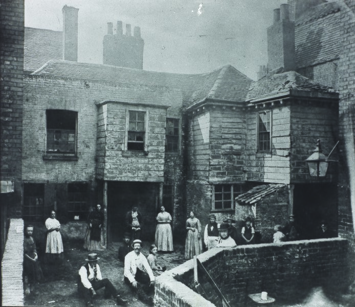
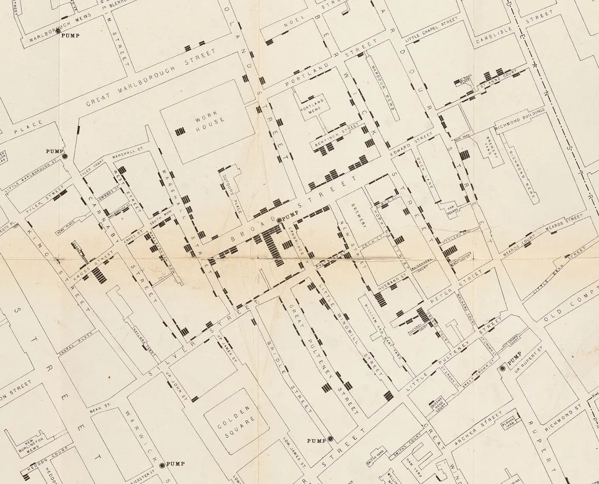
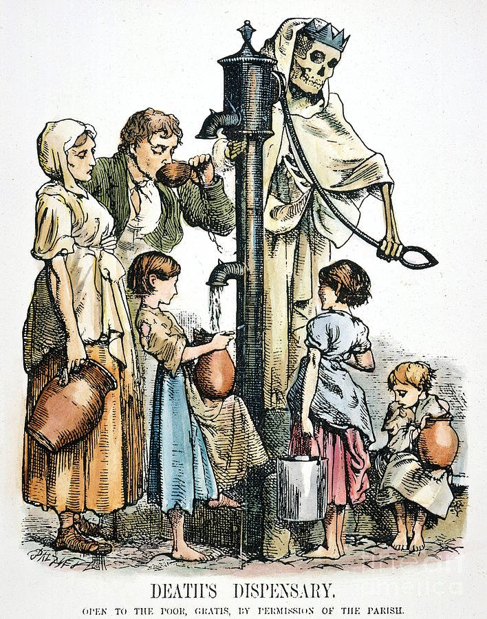
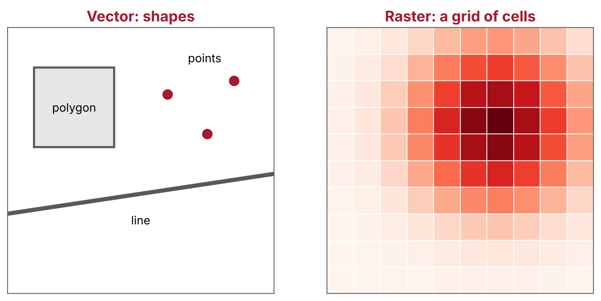
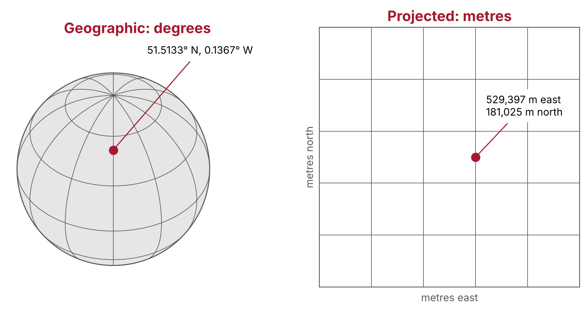
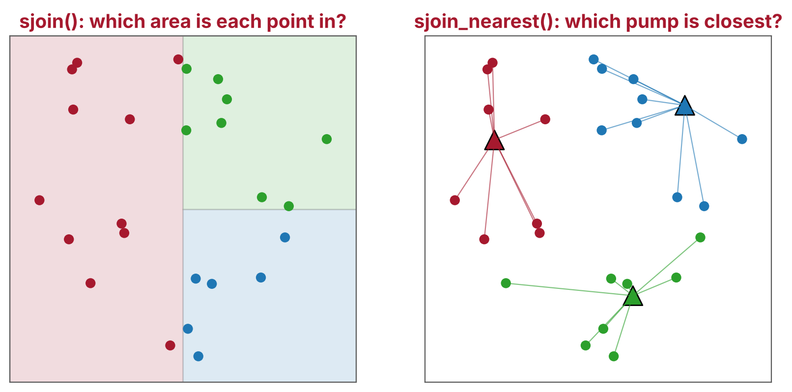
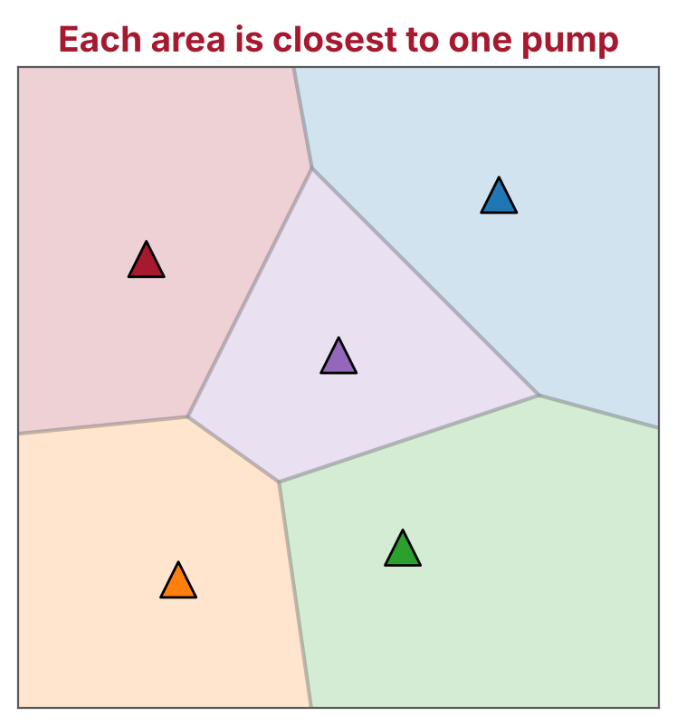
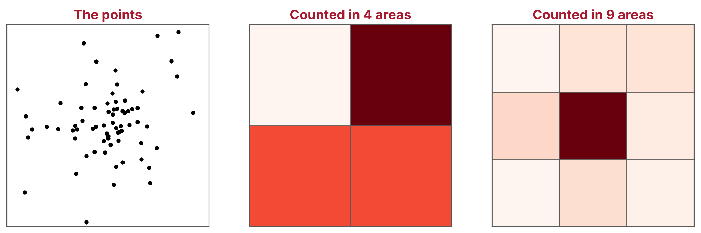

## Housekeeping

::: {.small}
- Please keep your **mic on mute** unless you're talking
- Feel free to turn your **camera** on if you want to
- We love **questions**! There's no such thing as a silly question here
- Don't be afraid of **error messages**: they're totally normal, and really helpful
- We'll take a **break** after 1 hour
- If you need an extra break at any point, that's okay: the session is recorded
:::

::: notes
Welcome everyone. Introduce yourself and the helpers. Point out the chat for questions.
:::

## How today works

::: {.medium}
Some theory. Then code it together.
:::

::: {.small}
- Each section starts with the **ideas** behind it
- Then we **live code** together: type along in your own copy of the notebook
- Then a short **exercise** on your own, and the answer
- Nothing to install: we use **Google Colab**, so you just need a Google account
- The **notes** have all the code, exercises and answers: try each exercise before looking
- We learn through one **case study**
:::

## Today's mission {.big .center}

::: {.center}
Can you find the source of a cholera outbreak, using a map?
:::

::: notes
Pose the question and leave it hanging. We answer it in section 3, and question the answer in section 5.
:::

## Session overview

::: {.cards .journey .grid3}
::: {.card .fragment}
**The story**
*Soho, 1854*
Cholera, two theories, and John Snow's map
:::
::: {.card .fragment}
**1 · Location data**
*What do the numbers mean?*
Vector and raster data, GeoDataFrames and coordinate reference systems
[Exercise: where is pump 0?]{.hands-on}
:::
::: {.card .fragment}
**2 · Making maps**
*How do we show it?*
Layers, background maps and interactive maps
[Exercise: an interactive map]{.hands-on}
:::
::: {.card .fragment}
**3 · The nearest pump**
*Which pump was closest?*
Spatial relationships and spatial joins
[Exercise: deaths within 100 metres]{.hands-on}
:::
::: {.card .fragment}
**4 · Pump catchments**
*Which area did each pump serve?*
Voronoi polygons and choropleth maps
[Exercise: a map of catchments]{.hands-on}
:::
::: {.card .fragment}
**5 · What the map cannot tell us**
*Should we believe it?*
The evidence beyond the map, and the limits of areas
[Exercise: question the map]{.hands-on}
:::
:::

::: notes
Click through the cards. Sections 1 to 4 each have theory, live coding and an exercise. Section 5 is a discussion, with no new code.
:::

## By the end, you will be able to

::: {.small}
1. **Load** location data into a GeoDataFrame, and **describe** how it differs from a pandas DataFrame
2. **Explain** what a coordinate reference system (CRS) is, and **check and change** it
3. **Make** a static map with a background map, and an interactive map
4. **Join** datasets by location, for example to find the nearest pump to each address
5. **Divide** an area into catchments around points, and **summarise** data within each one
6. **Describe** what a map can and cannot tell us
:::

::: notes
Objectives 1 and 2 are section 1, 3 is section 2, 4 is section 3, 5 is section 4 and 6 is section 5. We come back to this list at the end.
:::

# [00]{.section-number} The story {.section-divider background-color="var(--jgi-red)"}

[Soho, London, 1854]{.section-question}

## London in the 1850s

:::: {.columns}
::: {.column width="55%"}
::: {.small}
- A fast-growing city, with families crowded into old houses
- Sewage went into **cesspits** under and behind the houses
- Many people fetched their water from **street pumps**
- Cholera had already swept through Britain in the 1830s and 1840s
:::
:::
::: {.column width="45%"}
{fig-alt="Black and white photograph of a run-down London courtyard, with people standing and sitting outside old brick houses"}

[A London slum, 1860s. Wikimedia Commons]{.credit}
:::
::::

::: notes
Set the scene in a minute or two. The point to land: crowded housing, cesspits and shared pumps, side by side.
:::

## What is cholera?

:::: {.columns}
::: {.column width="55%"}
::: {.small}
- A gut infection caused by the bacterium ***Vibrio cholerae***
- Spread through **water and food** contaminated with it
- Causes acute watery diarrhoea, sometimes with vomiting
- Untreated, severe dehydration can kill **within hours**
- Today, most cases are treated with oral rehydration solution
:::

::: {.muted}
Source: [Global Task Force on Cholera Control](https://www.gtfcc.org/about-cholera/cholera-facts/)
:::
:::
::: {.column width="45%"}
{fig-alt="A cartoon of cholera as a giant shrouded figure with skeletal hands and feet, trampling soldiers on a battlefield"}

[*Cholera "Tramples the victors & the vanquished both"*, Robert Seymour, 1831. National Library of Medicine]{.credit}
:::
::::

::: notes
In 1854 nobody knew about the bacterium: it was not isolated until 1883. The cartoon shows how people saw cholera: a huge, looming presence that could strike anyone.
:::

## Two theories

:::: {.columns}
::: {.column width="50%"}
**Miasma**

::: {.bad}
Disease spreads through **"bad air"**, from rotting matter and filth. Most doctors believed this
:::
:::
::: {.column width="50%"}
**Water**

::: {.good}
John Snow, a London physician, thought cholera spread through **contaminated water**
:::
:::
::::

::: {.muted .center}
The two theories predict different patterns: bad air would spread across a neighbourhood, but water would cluster around its source
:::

::: notes
This is the key idea for the course: the theories predict different *spatial* patterns, so a map can help tell them apart.
:::

## The Broad Street outbreak

::: {.flow .one-line}
[**30 Aug 1854**<br>Outbreak starts]{.step .fragment} [→]{.arrow .fragment} [**1 Sep**<br>143 fatal cases]{.step .fragment} [→]{.arrow .fragment} [**Early Sep**<br>Snow visits homes]{.step .fragment} [→]{.arrow .fragment} [**7 Sep**<br>Evidence to parish]{.step .fragment} [→]{.arrow .fragment} [**8 Sep**<br>Handle removed]{.step .fragment}
:::

::: {.small}
- Snow studied the death records, and asked households where they got their water
- Most of the dead had lived near, and drunk from, the **Broad Street pump**
:::

::: {.muted}
Sources: [UCLA Department of Epidemiology](https://epi-snow.ph.ucla.edu/Stream2_BSPoutbreak_e.html), [CDC](https://www.cdc.gov/mmwr/preview/mmwrhtml/mm5334a1.htm)
:::

::: notes
"143 fatal cases begin" means 143 people who fell ill on 1 September went on to die. The handle was removed after Snow met the parish's Board of Guardians on the evening of 7 September.
:::

## Snow's map

:::: {.columns}
::: {.column width="60%"}
{fig-alt="John Snow's map of Soho, with each cholera death drawn as a small black bar stacked at its address, clustered around Broad Street"}
:::
::: {.column width="40%"}
::: {.small}
- Each **black bar** is one death, stacked at the address
- The **pumps** are marked on the map
- Published in 1855, in the second edition of Snow's *On the Mode of Communication of Cholera*
:::

[John Snow's map. Wellcome Collection]{.credit}
:::
::::

::: notes
Ask: what do you notice? Let people say "they cluster around one place" before you point to Broad Street.
:::

## The idea catches on

:::: {.columns}
::: {.column width="45%"}
{fig-alt="Cartoon of a skeleton working a street water pump, while poor women and children queue to fill jugs"}
:::
::: {.column width="55%"}
::: {.small}
*Death's Dispensary*, from the magazine *Fun*, 1866: Death himself works the pump

Snow died in 1858. Within a decade, the link between dirty water and disease was a subject for cartoons
:::

[George J. Pinwell, 1866. Public domain]{.credit}
:::
::::

## Our data

::: {.cards}
::: {.card}
**250**
addresses where one or more people died
:::
::: {.card}
**489**
deaths
:::
::: {.card}
**8**
water pumps
:::
:::

::: {.small}
Robin Wilson traced the deaths and pumps from Snow's map, and lined them up with a modern map: [johnsnow.rtwilson.com](https://johnsnow.rtwilson.com/)
:::

::: notes
These numbers come from the data. We get them ourselves in section 1.
:::

## Getting set up {.demo-slide}

[Together]{.demo-tag} [10 min]{.demo-meta}

1. Open the notebook from the course home page: **Open the notebook in Colab**
2. **File → Save a copy in Drive**
3. Run the first two cells (**Shift + Enter**)

```{python}
%pip install --quiet "geopandas>=1.0" contextily folium mapclassify
```

```{python}
import urllib.request
import zipfile

url = "https://johnsnow.rtwilson.com/data/SnowGIS_SHP.zip"
urllib.request.urlretrieve(url, "SnowGIS_SHP.zip")
with zipfile.ZipFile("SnowGIS_SHP.zip") as zip_file:
    zip_file.extractall()
```

::: notes
Share the home page link in the chat, and wait for thumbs up before moving on. Show the SnowGIS_SHP folder (folder icon on the left). Colab's "not authored by Google" warning: click Run anyway. If the download fails for everyone, use the backup copy (see the instructor notes).
:::

# [01]{.section-number} Location data {.section-divider background-color="var(--jgi-red)"}

[How is location data stored, and what do the numbers mean?]{.section-question}

## What makes data geospatial?

::: {.cards .grid2}
::: {.card}
**Where**
A location: a point, a line or an area, given as coordinates
:::
::: {.card}
**What**
The values we know about that place: the number of deaths at an address
:::
::: {.card}
**Health examples**
Patients' postcodes, GP surgeries, hospital catchments, air pollution
:::
::: {.card}
**What it adds**
Location links datasets that share nothing else, and shows patterns a table can hide
:::
:::

## Why location matters

::: {.medium .center}
"Everything is related to everything else, but near things are more related than distant things."
:::

::: {.muted .center}
Waldo Tobler's "first law of geography", 1970
:::

::: {.small}
- Things close together tend to be alike: neighbouring streets share the same air, water and services
- So a **cluster** that stands out from its surroundings is worth explaining
- In 1854, a cluster of deaths around one pump pointed to the water
:::

## Two ways to store the world

{fig-alt="Left: a map with a square polygon, a line and three points. Right: the same area as a grid of cells, shaded from pale to dark red" width="70%" fig-align="center"}

::: {.doc-table}

| | Vector | Raster |
|---|---|---|
| **Stores** | Shapes, each with a row of values | A grid of cells, each with a value |
| **Best for** | Things with edges: buildings, roads, addresses | Things that vary smoothly: air pollution, temperature |
| **Files** | Shapefile, GeoPackage, GeoJSON | GeoTIFF |
| **Python** | geopandas | rasterio, xarray |

:::

::: notes
Today is all vector data. The one raster we use is SnowMap.tif, a scan of Snow's map, as a background in an optional extra. A raster's resolution (its cell size) sets the smallest detail it can show.
:::

## Vector data: points, lines and polygons

::: {.cards}
::: {.card}
**Points**
An address, a pump, a hospital
:::
::: {.card}
**Lines**
A road, a river, a bus route
:::
::: {.card}
**Polygons**
A building, a postcode area, a catchment
:::
:::

::: {.flow .one-line}
[A table of values]{.step .light} [+]{.arrow} [A geometry column]{.step} [=]{.arrow} [A GeoDataFrame]{.step}
:::

::: notes
Today we use points (deaths and pumps) and, in section 4, polygons. A GeoDataFrame is a pandas DataFrame with one extra column, so everything they know about pandas still works.
:::

## Reading the data {.demo-slide}

[Together]{.demo-tag} [live code]{.demo-meta}

```{python}
import geopandas as gpd
import pandas as pd

deaths = gpd.read_file("SnowGIS_SHP/Cholera_Deaths.shp")
pumps = gpd.read_file("SnowGIS_SHP/Pumps.shp")
deaths.head()
```

::: {.cards}
::: {.card}
**GeoDataFrame**
A pandas DataFrame with a `geometry` column
:::
::: {.card}
**Shapefile**
Several files that travel together: `.shp`, `.dbf`, `.shx`, `.prj`
:::
:::

::: notes
Live code: read both files, deaths.head(), type(deaths), len(deaths) and Count.sum() (250 and 489), value_counts(). Then pumps: 8 rows, geometry only, so add pump_id with range(len(pumps)). deaths.plot(), and ask: what are the numbers on the axes?
:::

## Coordinate reference systems

{fig-alt="Left: a globe with lines of latitude and longitude, and the Broad Street pump at 51.5133 north, 0.1367 west. Right: a flat grid in metres, with the same pump at 529,397 metres east and 181,025 metres north" width="70%" fig-align="center"}

::: {.small}
A coordinate is just two numbers. The **CRS** says what they are measured from, and in what units
:::

::: notes
Same pump, two sets of numbers. On the left, angles on a curved Earth. On the right, metres on a flat grid.
:::

## Geographic or projected?

::: {.cards .grid2}
::: {.card}
**Geographic CRS**
Latitude and longitude, in **degrees**, on the curved Earth. GPS and web maps use WGS 84 (EPSG:4326)
:::
::: {.card}
**Projected CRS**
The Earth flattened onto a grid, in **metres**. The British National Grid (EPSG:27700) is made for Great Britain
:::
:::

::: {.bad .compact}
✘ Flattening the Earth always distorts something: area, shape, distance or direction. No map keeps them all
:::

::: {.good .compact}
✔ Measure distances and areas in a projected CRS made for your area
:::

::: notes
A degree of longitude is about 111 km at the equator and about 69 km in London, so distances in degrees are meaningless. EPSG codes are ID numbers for CRSs: look them up at epsg.io.
:::

## set_crs() or to_crs()?

```{python}
# Label the data with its CRS: the numbers do not change
deaths = deaths.set_crs(27700, allow_override=True)
pumps = pumps.set_crs(27700, allow_override=True)

# Convert to latitude and longitude: the numbers change
deaths_latlon = deaths.to_crs(4326)
```

::: {.good}
✔ `set_crs()` **labels**: use it when the CRS is missing or wrong
:::

::: {.good}
✔ `to_crs()` **converts**: use it to change CRS
:::

::: {.bad}
✘ Measuring distances in latitude and longitude: the answer is in degrees
:::

::: notes
Live code the distance from each death to pump 0 in both CRSs, and show the warning geopandas gives for degrees. Also note: POINT (x y) puts longitude first.
:::

## Where is pump 0? {.demo-slide}

[Your turn]{.your-turn-tag} [5 min]{.demo-meta}

1. Convert `pumps` to latitude and longitude
2. Find the latitude and longitude of pump 0 (the first row)
3. Paste them into Google Maps or OpenStreetMap as `latitude, longitude`. **Which street is it on?**

::: {.muted}
Hint: `.geometry.y` and `.geometry.x`. Exercise 1 in the notes.
:::

::: notes
Ask people to post the street name in the chat. The Indian Ocean means latitude and longitude are swapped.
:::

## Pump 0 is the Broad Street pump {.demo-slide}

[Answer]{.answer-tag} [3 min]{.demo-meta}

```{python}
pumps_latlon = pumps.to_crs(4326)
pumps_latlon.geometry.y.iloc[0], pumps_latlon.geometry.x.iloc[0]
```

::: {.medium}
About **51.5133, -0.1367**: Broadwick Street, called Broad Street in 1854
:::

::: notes
A replica pump stands on Broadwick Street today. From now on, pump 0 is "Broad Street".
:::

## Learn more about location data

::: {.small}
- [GeoPandas: introduction](https://geopandas.org/en/stable/getting_started/introduction.html)
- [GeoPandas: managing projections](https://geopandas.org/en/stable/docs/user_guide/projections.html)
- [*Python for Geographic Data Analysis*](https://pythongis.org/): vector and raster data, and CRSs
- [epsg.io](https://epsg.io/): look up any CRS
:::

## Break {.center}

::: {.big .center}
10 minutes
:::

::: notes
About 1 hour in. Colab may disconnect if left idle: if so, rerun the notebook (Runtime → Run before).
:::

# [02]{.section-number} Making maps {.section-divider background-color="var(--jgi-red)"}

[How do we turn a table of points into a map that people can read?]{.section-question}

## What makes a good map?

::: {.cards .grid2}
::: {.card}
**The data**
The layer you want people to look at, drawn so it stands out
:::
::: {.card}
**Context**
A background map, so readers know where they are
:::
::: {.card}
**A key**
A legend or caption that says what the symbols mean
:::
::: {.card}
**Credit**
Where the data and the background map came from
:::
:::

## Showing values on a map

::: {.doc-table}

| | Good for | In geopandas | On Snow's map |
|---|---|---|---|
| **Size** | Amounts, such as a count | `markersize=` | The height of each stack of bars |
| **Colour** | Amounts, or categories | `column=`, `cmap=` | Not used |
| **Shape** | Different kinds of thing | `marker=` | Bars for deaths, dots for pumps |

:::

::: {.muted .center}
Snow showed the number of deaths at each address by the height of the stack: we will use the size of each dot
:::

## Layers {.demo-slide}

[Together]{.demo-tag} [live code]{.demo-meta}

```{python}
ax = deaths.plot(
    color="black", markersize=deaths["Count"] * 10, alpha=0.7, figsize=(8, 8)
)
pumps.plot(ax=ax, color="blue", marker="^", markersize=80)
ax.set_axis_off()
```

::: {.flow}
[Deaths]{.step} [+]{.arrow} [Pumps]{.step} [+]{.arrow} [Street map]{.step .light}
:::

::: notes
Build it up a step at a time: deaths.plot(), then color, then markersize as a number, then from Count, then the pumps with ax=ax. Compare to Snow's stacked bars. Ask: what do you notice?
:::

## A background map

```{python}
import contextily as cx

ax = deaths.plot(
    color="black", markersize=deaths["Count"] * 10, alpha=0.7, figsize=(8, 8)
)
pumps.plot(ax=ax, color="blue", marker="^", markersize=80)
cx.add_basemap(ax, crs=deaths.crs, source=cx.providers.Esri.WorldStreetMap)
ax.set_axis_off()
```

::: {.small}
- `crs=deaths.crs` fits the map tiles to our data
- Keep the attribution in the corner
:::

::: notes
If time, show the optional extra in the notes: source="SnowGIS_SHP/SnowMap.tif" puts the points on Snow's own map, a raster.
:::

## An interactive map

```{python}
deaths.explore(
    column="Count",
    cmap="Reds",
    marker_kwds={"radius": 4},
    tiles="Esri.WorldStreetMap",
)
```

::: {.cards}
::: {.card}
**.plot()**
Static: reports, papers, slides
:::
::: {.card}
**.explore()**
Interactive: exploring data, web pages
:::
:::

::: notes
Zoom in and hover over points. explore() converts to the web map CRS for you.
:::

## An interactive map {.demo-slide}

[Your turn]{.your-turn-tag} [7 min]{.demo-meta}

::: {.small}
1. Save the map of the deaths as `m`, with `name="Deaths"`
2. Add the pumps: `pumps.explore(m=m, color="blue", name="Pumps")`
3. Add a layer control: `folium.LayerControl().add_to(m)`, after `import folium`
4. Hover to find the address with the **most deaths**. Is it near a pump?
:::

::: {.muted}
Exercise 2 in the notes.
:::

## The worst-hit address {.demo-slide}

[Answer]{.answer-tag} [3 min]{.demo-meta}

```{python}
m = deaths.explore(
    column="Count",
    cmap="Reds",
    marker_kwds={"radius": 4},
    tiles="Esri.WorldStreetMap",
    name="Deaths",
)
pumps.explore(m=m, color="blue", marker_kwds={"radius": 8}, name="Pumps")
folium.LayerControl().add_to(m)
m

worst = deaths.loc[deaths["Count"].idxmax()]
worst["geometry"].distance(pumps.geometry.iloc[0])
```

::: {.medium}
**15 deaths**, about **17 metres** from the Broad Street pump
:::

## Learn more about maps

::: {.small}
- [GeoPandas: mapping and plotting](https://geopandas.org/en/stable/docs/user_guide/mapping.html)
- [GeoPandas: interactive maps](https://geopandas.org/en/stable/docs/user_guide/interactive_mapping.html)
- [contextily](https://contextily.readthedocs.io/): background maps
:::

# [03]{.section-number} The nearest pump {.section-divider background-color="var(--jgi-red)"}

[Which pump was closest to each death?]{.section-question}

## Spatial relationships

{fig-alt="Left: points coloured by which of three areas they fall in. Right: points joined by lines to the nearest of three pumps, and coloured to match" width="70%" fig-align="center"}

::: {.small}
Two shapes can **intersect**, one can **contain** the other, or they can be a **distance** apart. These relationships let us join tables by location
:::

## Joining tables

::: {.cards}
::: {.card}
**Join by a column**
`pd.merge()`: rows with the same value in a shared column, such as a patient ID
:::
::: {.card}
**Join by location**
`sjoin()`: rows whose shapes intersect, or where one contains the other
:::
::: {.card}
**Join to the nearest**
`sjoin_nearest()`: each row to the closest row of the other table
:::
:::

::: {.muted .center}
A spatial join links datasets that share nothing but their location
:::

::: notes
For example, a spatial join can give each patient's postcode the area it is in, so it can be matched to deprivation data for that area.
:::

## Joining by location {.demo-slide}

[Together]{.demo-tag} [live code]{.demo-meta}

```{python}
nearest = deaths.sjoin_nearest(pumps, distance_col="distance")
nearest.head()
```

::: {.small}
- `index_right`: the pump's row (added by every spatial join)
- `pump_id`: the pump's number
- `distance`: in metres, as the data is in the British National Grid
:::

::: notes
Straight-line distance: flag that we come back to this in section 5.
:::

## Deaths per pump

```{python}
deaths_per_pump = nearest.groupby("pump_id")["Count"].sum()
deaths_per_pump.sort_values(ascending=False)
```

::: {.doc-table}

| Pump | 0 | 1 | 4 | 5 | 7 | 2 | 3 | 6 |
|---|---|---|---|---|---|---|---|---|
| Deaths | **340** | 65 | 40 | 27 | 12 | 5 | 0 | 0 |

:::

::: {.medium .center}
**70%** of the 489 deaths were nearest the Broad Street pump
:::

::: notes
Pumps 3 and 6 are missing from the groupby output (no address had them as nearest), so they show as 0 here. Then nearest["distance"].describe() (about 105 m on average, 316 m at most) and the map coloured by pump_id with categorical=True.
:::

## Deaths within 100 metres {.demo-slide}

[Your turn]{.your-turn-tag} [7 min]{.demo-meta}

1. `broad_street = pumps.geometry.iloc[0]`
2. Use `deaths.distance(broad_street)` to find the addresses within **100 metres**
3. How many **deaths** were at those addresses? What **percentage** of all deaths?

::: {.muted}
Extra: `broad_street.buffer(100)` makes a 100 metre circle. Map it. Exercise 3 in the notes.
:::

## 196 deaths within 100 metres {.demo-slide}

[Answer]{.answer-tag} [3 min]{.demo-meta}

```{python}
broad_street = pumps.geometry.iloc[0]
within_100m = deaths[deaths.distance(broad_street) <= 100]
deaths_near = within_100m["Count"].sum()
deaths_near, 100 * deaths_near / deaths["Count"].sum()
```

::: {.medium}
**196 deaths**, 40% of the total, within 100 metres of the pump
:::

## Learn more about spatial joins

::: {.small}
- [GeoPandas: merging data](https://geopandas.org/en/stable/docs/user_guide/mergingdata.html)
- [Shapely: spatial predicates](https://shapely.readthedocs.io/en/stable/manual.html#binary-predicates)
:::

# [04]{.section-number} Pump catchments {.section-divider background-color="var(--jgi-red)"}

[Which area did each pump serve?]{.section-question}

## Voronoi polygons

:::: {.columns}
::: {.column width="45%"}
{fig-alt="Five pumps, each inside its own coloured area. Every point in an area is closer to that area's pump than to any other"}
:::
::: {.column width="55%"}
::: {.small}
- Each polygon is the area **closest** to one point
- The edges are where you are the same distance from two points
- Named after Georgy Voronoy (1908). Also called **Thiessen polygons**, after a meteorologist who used them for rainfall in 1911
- Used today for catchments, such as the nearest GP surgery or hospital
:::
:::
::::

## Snow drew one too

::: {.medium}
For the parish's inquiry, Snow redrew his map with a **dotted line** around the area closer to the Broad Street pump than to any other
:::

::: {.small}
- He measured the distance **along the streets**, not in a straight line
- It may be the earliest use of this kind of diagram
:::

::: {.muted}
Source: [UCLA Department of Epidemiology](https://epi-snow.ph.ucla.edu/Stream2_BSPoutbreak_f.html)
:::

## Voronoi polygons in geopandas {.demo-slide}

[Together]{.demo-tag} [live code]{.demo-meta}

```{python}
from shapely.geometry import box

all_points = pd.concat([deaths.geometry, pumps.geometry])
xmin, ymin, xmax, ymax = all_points.total_bounds
study_area = box(xmin - 50, ymin - 50, xmax + 50, ymax + 50)

cells = pumps.voronoi_polygons(extend_to=study_area)
catchments = gpd.GeoDataFrame(geometry=cells)
catchments = catchments.sjoin(pumps, predicate="contains").clip(study_area)
```

::: {.small}
- The box gives the outer polygons an edge
- The polygons are **not** in the order of the pumps, so a spatial join labels them
:::

::: notes
Show cells first, then the join, then the plot coloured by pump_id with the pumps and deaths on top.
:::

## Deaths in each catchment

```{python}
deaths_in_catchment = deaths.sjoin(catchments[["pump_id", "geometry"]])
deaths_in_catchment.groupby("pump_id")["Count"].sum()
```

::: {.medium}
The same totals as the nearest pump. Why?
:::

::: notes
Wait for answers in the chat. Each polygon is the area nearest its pump, so the methods must agree. The polygons add the areas, including where no one died.
:::

## Choropleth maps

::: {.cards .grid2}
::: {.card}
**What it is**
A map of areas, each shaded by a value
:::
::: {.card}
**Counts mislead**
Areas with more people have more deaths, whatever the cause
:::
::: {.card}
**Rates are fairer**
Deaths per 1,000 people compares areas with different populations
:::
::: {.card}
**Our data**
We have no population figures, so we can only map counts
:::
:::

## A map of catchments {.demo-slide}

[Your turn]{.your-turn-tag} [7 min]{.demo-meta}

```{python}
totals = deaths_in_catchment.groupby("pump_id")["Count"].sum()
catchments["deaths"] = catchments["pump_id"].map(totals).fillna(0)
```

1. Plot `catchments` with `column="deaths"`, `cmap="Reds"` and `legend=True`
2. Add the pumps and a background map
3. Which catchments had **no deaths**?

::: {.muted}
Exercise 4 in the notes.
:::

## The catchment map {.demo-slide}

[Answer]{.answer-tag} [3 min]{.demo-meta}

```{python}
ax = catchments.plot(
    column="deaths",
    cmap="Reds",
    legend=True,
    edgecolor="black",
    figsize=(8, 8),
)
pumps.plot(ax=ax, color="blue", marker="^", markersize=80)
cx.add_basemap(ax, crs=deaths.crs, source=cx.providers.Esri.WorldStreetMap)
ax.set_axis_off()
```

::: {.small}
Pumps **3** and **6** had no deaths in their catchments
:::

# [05]{.section-number} What the map cannot tell us {.section-divider background-color="var(--jgi-red)"}

[Should we believe it?]{.section-question}

## The evidence beyond the map

::: {.cards .grid2}
::: {.card .fragment}
**Straight lines**
For some homes the Rupert Street pump was closer, but dead ends made Broad Street quicker to reach
:::
::: {.card .fragment}
**The brewery**
No deaths in the blocks east of the pump. The brewery had its own well, and its workers drank beer
:::
::: {.card .fragment}
**The Hampstead widow**
Susannah Eley had Broad Street water delivered to Hampstead. She and her niece caught cholera
:::
::: {.card .fragment}
**The first case**
A curate, Henry Whitehead, traced it to a baby at 40 Broad Street, whose washing water went into a cesspit by the pump
:::
:::

::: notes
None of these shows up as a cluster on a map: they came from talking to people. Snow's case was persuasive because the map fitted with this evidence. The cesspit's cracked lining leaked into the pump's well. Sources are linked in the notes.
:::

## The limits of the data

::: {.small}
- **Where people died, not where they drank**: home addresses only
- **Who is missing**: people who died somewhere else, like Susannah Eley
- **Traced by hand**: the positions are approximate
- **Timing**: the outbreak was already slowing when the handle was removed
- **Correlation, not cause**: a cluster near a pump does not prove the pump caused it
:::

## The boundaries change the picture

{fig-alt="The same set of points counted in four large squares and in nine smaller squares. With four squares, one corner looks worst; with nine, the centre does" width="80%" fig-align="center"}

::: {.small}
The **modifiable areal unit problem**: the same data, counted in different areas, can show a different pattern
:::

::: notes
Health data is usually released for areas, not addresses, to protect privacy. Both the size of the areas and where their boundaries fall can change where the "hotspot" appears. Our catchments are one choice of areas.
:::

## Question the map {.demo-slide}

[Your turn]{.your-turn-tag} [5 min]{.demo-meta}

Pick one question, and answer in the chat:

1. With only the catchment map and no interviews, what could you **wrongly conclude**?
2. What **extra data** would make the analysis stronger?
3. Think of location data from **your own work**. What would a map of it leave out?

::: {.muted}
Exercise 5 in the notes.
:::

::: notes
Read out a few answers. Draw out: no population, so no rates (a crowded street has more deaths); no dates; no record of where people got water; walking distance on 1854 streets; boundaries change the pattern.
:::

# Summary {.section-divider background-color="var(--jgi-red)"}

## What you can now do

::: {.small}
- ✔ **Load** location data, and **explain** vector and raster data
- ✔ **Check and change** a CRS, and measure in metres
- ✔ **Make** static and interactive maps
- ✔ **Join** tables by location
- ✔ **Draw** catchments, and summarise data within them
- ✔ **Question** what a map shows
:::

::: notes
Go back to the objectives slide and tick them off.
:::

## Where next?

::: {.small}
- [GeoPandas user guide](https://geopandas.org/en/stable/docs/user_guide.html)
- [*Python for Geographic Data Analysis*](https://pythongis.org/) (free online book)
- [*Geographic Data Science with Python*](https://geographicdata.science/book/intro.html) (free online book, including spatial statistics)
- UK boundaries: [ONS Open Geography Portal](https://geoportal.statistics.gov.uk/)
- [Bristol Training courses](https://bristol-training.github.io/)
:::

## Image credits

::: {.small}
- John Snow's map: public domain. Colour scan: Wellcome Collection
- A London slum, 1860s: Wikimedia Commons, public domain
- *Cholera "Tramples the victors & the vanquished both"*: Robert Seymour, 1831. National Library of Medicine, public domain
- *Death's Dispensary*: George J. Pinwell, *Fun*, 1866, public domain
- Diagrams: Jean Golding Institute, CC BY 4.0
:::

## Thank you {.center}

::: {.big .center}
Questions?
:::

::: notes
Ask people to fill in the feedback form.
:::
